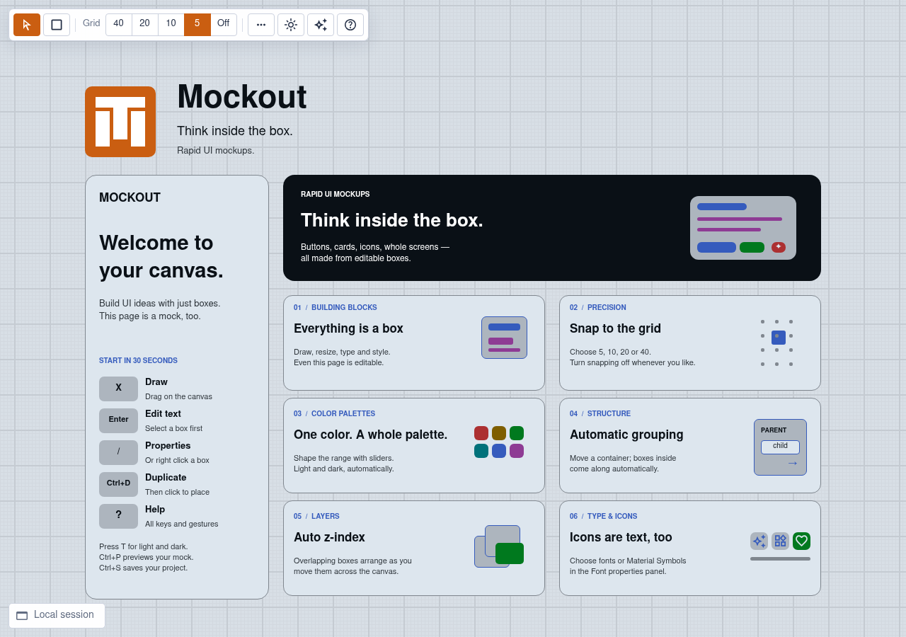

<div align="center">
  <picture>
    <source media="(prefers-color-scheme: dark)" srcset="public/assets/logo-dark.svg">
    
  </picture>

  <h1>Mockout</h1>

  <p><strong>Think inside the box: Rapid UI Mockups</strong></p>
  <p><a href="https://mockout.sector-seven.com/">Open Mockout</a></p>
</div>

<p align="center">
  <picture>
    <source media="(prefers-color-scheme: dark)" srcset="support/screenshots/overview-dark.png">
    
  </picture>
</p>

Mockout is a small browser tool for sketching interfaces and other 2D layouts.
Draw boxes, add text, and arrange your ideas—by hand or together with your own
AI assistant. The editable Welcome project shows what you can make.

## Start sketching

1. Press **D** and drag to draw a box.
2. Select a box and press **Enter** to edit its text.
3. Right click a box to change its shape, colors, text, or font.
4. Press **?** to see all keyboard and mouse controls.

Everything is a box, including labels, buttons, panels, and icons. Boxes inside
a larger box move with it, and overlapping boxes arrange their layer order as
you work. Use the grid to keep sizes and positions aligned. Right click the
canvas and choose **Grid** to set its smallest size and major-line spacing.

Press **O** to edit individual border edges and corners. Select a marker, then
change its width, color, or radius in the attached inspector. Press **P** to
edit padding on each edge. Use **Alt+←/→** to cycle through points while editing
their values. Press **/** to open properties, and **Esc** to go back or close
the inspector.

Use **Alt+1–4** to open or switch property sections, including from a focused
field. From the canvas, **/** followed by **1–4** chooses a section from the
properties menu. Plain **1–5** on the canvas selects a grid size or turns it off.

Start with one color and shape a whole palette with sliders. Named palette colors
stay linked across your mockup, and light/dark variants are built in. Palettes use
OKLCH and offer Inverse, Same, and Custom dark modes. Press **T** to switch themes.
You can also choose fonts and Material icons in box properties.

## Work with AI

Use your own AI assistant to create and refine mockups while you watch. Connect
a shared project file, describe what you want, and see changes appear on the
canvas. Your assistant needs access to files on your computer.

Choose the **AI** sparkle button next to Help to copy a skill setup prompt or a
quick-run prompt into your AI app.

The [Mockout skill](public/skills/mockout/SKILL.md) guides an agent through sharing
a local project file, then builds the mockup box by box with live updates.

For repeated use, ask your agent to install the
[skill folder from GitHub](https://github.com/dannyben/mockout/tree/master/public/skills/mockout).
For one session, ask it to read and follow the
[hosted instructions](https://mockout.sector-seven.com/skills/mockout/SKILL.md).
The folder includes the schema, a blank starter, an email-client example, and the
complete Welcome project with icons and light/dark colors.

## Keep your work

Your current project is saved automatically in this browser. Use **Save JSON**
to keep a portable copy, and **Load JSON** to reopen it. When saving from Local
Session, choose **Save once** to write a file and keep working locally, or
**Save and connect** to automatically save edits and load external changes.
**Preview** opens your mock without the editor controls or grid.
**Export PNG…** (**Ctrl+E**) saves the entire mockup at 2× resolution with
a 20 px margin, using the current theme and canvas background. Choose a location
in the native Save As dialog; browsers without file picker support download the
image instead.

When loading or dropping a project, choose **Open a local copy** to explore it
without changing the original. Edits stay in Local Session; **Ctrl+S** lets you
choose how to save. Choose **Open connected file** to enable automatic saving
and loading of external changes. If you decline file permission, it opens as a
local copy.

The bottom-left status shows **Local session** or the connected filename.
Connected files save automatically after edits, including undo and redo. A check
shows the file connection; routine saves stay quiet. Mockout remembers it across
reloads; choose **Reconnect** if the browser needs read/write permission again.
Choose **Work locally** beside it to forget the connection and keep the current
canvas in browser storage.

While connected, **Ctrl+S** saves directly. **Save as…** offers both save choices
again. Choosing **Save once** returns to Local Session after the file is saved;
cancelling keeps your existing connection.

On supported browsers, external file edits appear live; Mockout also checks when
you return to the tab. Valid changes reload silently if your canvas has no unsaved
edits. If both changed, editing pauses and your canvas is kept: choose **Reload
file** to use the file's version, or **Save ours** to replace it with your canvas.

To explore the Welcome project again, choose **New blank**, then
**Show Welcome example** in Help.

## Run locally

Use Node.js 22.18 or later and pnpm (the version is pinned in `package.json`).
Run `op serve` or `pnpm run dev` to start Vite at `http://0.0.0.0:3000`.
Development and preview use a strict port; development watches shared folders
with polling.

On this VM, keep `node_modules` outside `/vagrant`. Before installing, create an
external directory and link it, for example:

```sh
mkdir -p /home/vagrant/.swap/html/mockout/node_modules
ln -s /home/vagrant/.swap/html/mockout/node_modules node_modules
op install
```

Keep an existing external link. `op install` verifies it, stages the manifest,
workspace settings and lockfile beside its target, runs pnpm there with one
dependency operation at a time, then copies the lockfile back. It skips dependency
scripts. Run installs, builds, tests and file scans serially. Automatic installs
before pnpm scripts are disabled; use `op install` after dependency changes.

Run `op test` for core and editor-state checks, `op build` to build `dist/`, then
`op test-browser` for Chromium interaction and file-sync tests against that build.
`op check` runs those three steps serially. The browser tests use an isolated
profile and browser-owned files; they do not touch your saved projects.

Run `op preview` to serve the build at `http://0.0.0.0:3000`. Run `op screenshots`
to build and refresh both README screenshots from Welcome. Browser checks need
Chromium; screenshots also need access to Google Fonts. Set `CHROMIUM_BIN` if
your browser executable is named differently.

Wrangler builds with `pnpm run build` and serves only `dist/`. Deployment is a
separate, manual action (`pnpm dlx wrangler deploy`); local checks do not deploy.

## Source layout

- `src/core/`: DOM-free project validation, version-1 serialization, geometry,
  selection, fonts, borders and palette calculations.
- `src/editor/`: document/history commands, transient editor state, view snapshots,
  color drafts and file synchronization. The runtime exposes explicit UI commands
  and owns native listener, timer and file-observer cleanup. Native DOM anchors
  support pointer capture, text selection, focus restoration and layout measurement.
- `src/ui/`: React owns the canvas boxes/handles/guides, inspector forms and color
  editors, toolbar, help, dialogs and status. Keyed boxes preserve node identity;
  active text editors and unfinished field input stay intact through rerenders.
- `public/`: static assets, Welcome and the downloadable AI skill/examples.

React subscribes to cached view snapshots through `useSyncExternalStore` and
invokes editor commands rather than mutating the document. Project edits pass
through the editor's undo/redo and persistence path; color previews stay in a
draft until Save. Browser file handles, permissions, polling and revision guards
remain in the native file service. The storage keys, file-connection database and
version-1 project format are unchanged. Unsupported saved data is left untouched
and autosave stays paused.

---


