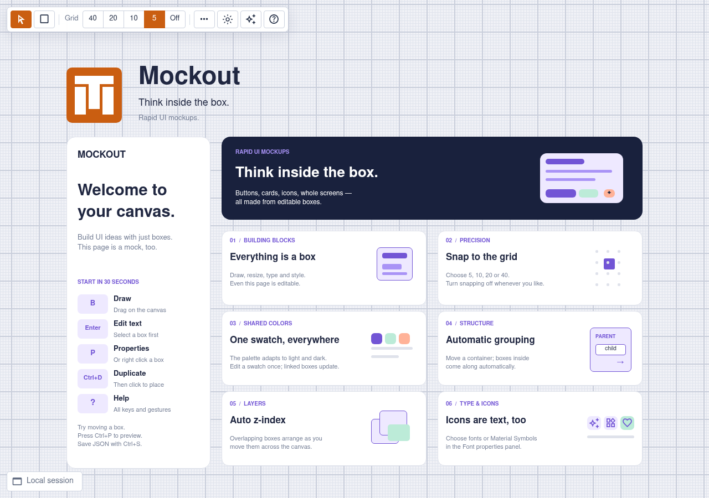

  <picture>
    <source media="(prefers-color-scheme: dark)" srcset="public/assets/logo-dark.svg">
    
  </picture>

  <h1>Mockout</h1>

  
<strong>Think inside the box: Rapid UI Mockups</strong>

  
<a href="https://mockout.sector-seven.com/">Open Mockout</a>

  <picture>
    <source media="(prefers-color-scheme: dark)" srcset="support/screenshots/overview-dark.png">
    
  </picture>

Mockout is a small browser tool for sketching interfaces and other 2D layouts.
Draw boxes, add text, and arrange them into an idea you can see and change
quickly. The editable Welcome project shows what you can make.

## Start sketching

1. Press **B** and drag to draw a box.
2. Select a box and press **Enter** to edit its text.
3. Right click a box to change its shape, colors, text, or font.
4. Press **?** to see all keyboard and mouse controls.

Everything is a box, including labels, buttons, panels, and icons. Boxes inside
a larger box move with it, and overlapping boxes arrange their layer order as
you work. Use the grid to keep sizes and positions aligned. Right click the
canvas and choose **Grid** to set its smallest size and major-line spacing.

Press **O** to edit individual border edges and corners. Select a marker, then
change its width, color, or radius in the attached inspector. Press **P** to
edit padding on each edge. Use **Alt+←/→** to cycle through points while editing
their values. Press **/** to open properties, and **Esc** to go back or close
the inspector.

Every box color uses a named swatch. Change a swatch once to update all boxes
that use it. Swatches and canvas colors support light and dark appearances;
dark colors default to Invert, with Same and Custom options. You can also choose
fonts and Material icons in box properties.

## Keep your work

Your current project is saved automatically in this browser. Use **Save JSON**
to keep a portable copy, and **Load JSON** to reopen it. When saving from Local
Session, choose **Save once** to write a file and keep working locally, or
**Save and connect** to automatically save edits and load external changes.
**Preview** opens your mock without the editor controls or grid.

When loading or dropping a project, choose **Open a local copy** to explore it
without changing the original. Edits stay in Local Session; **Ctrl+S** lets you
choose how to save. Choose **Open connected file** to enable automatic saving
and loading of external changes. If you decline file permission, it opens as a
local copy.

The bottom-left status shows **Local session** or the connected filename.
Connected files save automatically after edits, including undo and redo. A check
shows the file connection; routine saves stay quiet. Mockout remembers it across
reloads; choose **Reconnect** if the browser needs read/write permission again.
Choose **Work locally** beside it to forget the connection and keep the current
canvas in browser storage.

While connected, **Ctrl+S** saves directly. **Save as…** offers both save choices
again. Choosing **Save once** returns to Local Session after the file is saved;
cancelling keeps your existing connection.

On supported browsers, external file edits appear live; Mockout also checks when
you return to the tab. Valid changes reload silently if your canvas has no unsaved
edits. If both changed, editing pauses and your canvas is kept: choose **Reload
file** to use the file's version, or **Save ours** to replace it with your canvas.

To explore the Welcome project again, choose **New blank**, then
**Show Welcome example** in Help.

## Work with AI

Choose the **AI** sparkle button next to Help to copy a skill setup prompt or a
quick-run prompt into your AI app.

The [Mockout skill](public/skills/mockout/SKILL.md) guides an agent through sharing
a local project file, then builds the mockup box by box with live updates.
The agent needs read/write access to the same file connected in your browser.

For repeated use, ask your agent to install the
[skill folder from GitHub](https://github.com/dannyben/mockout/tree/master/public/skills/mockout).
For one session, ask it to read and follow the
[hosted instructions](https://mockout.sector-seven.com/skills/mockout/SKILL.md).
The folder includes the schema, a blank starter, an email-client example, and the
complete Welcome project with icons and light/dark colors.

## Run locally

Serve the `public` folder with any static web server, or run `op serve` with
[httpme](https://github.com/DannyBen/httpme) installed. There is no build step.

Run `op test` for the project checks. Run `op screenshots` to refresh both README
screenshots from the Welcome project. The screenshot script needs Node.js 22 or
later, Chromium, and access to Google Fonts. Set `CHROMIUM_BIN` if your browser
executable is named differently.

---

